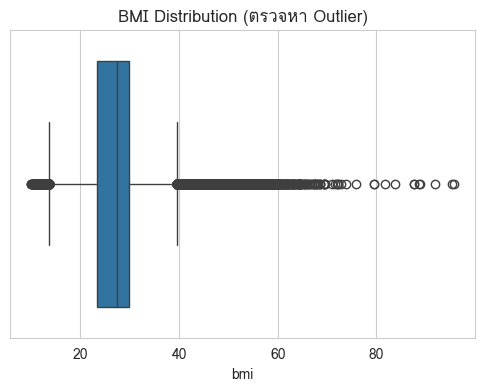
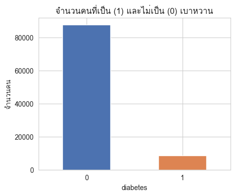
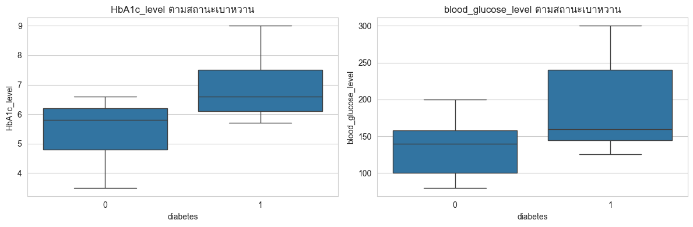
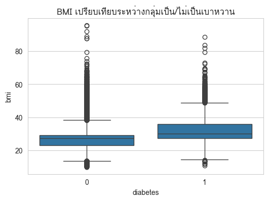
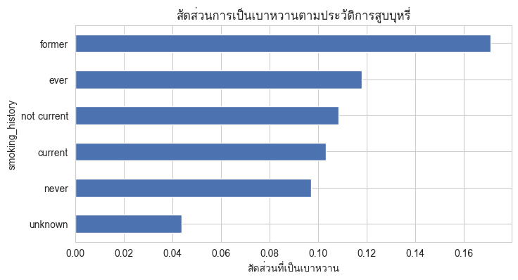
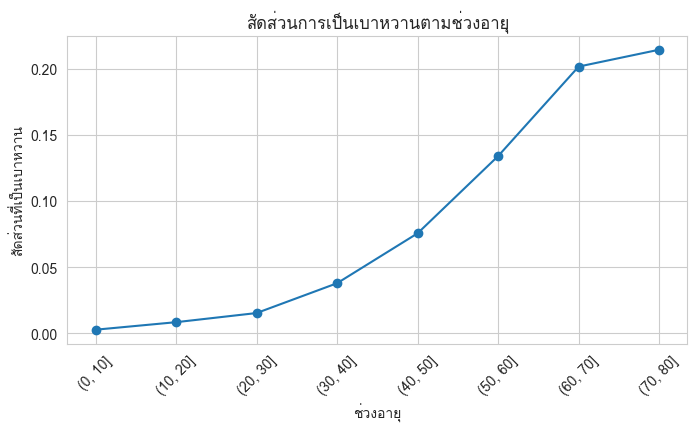
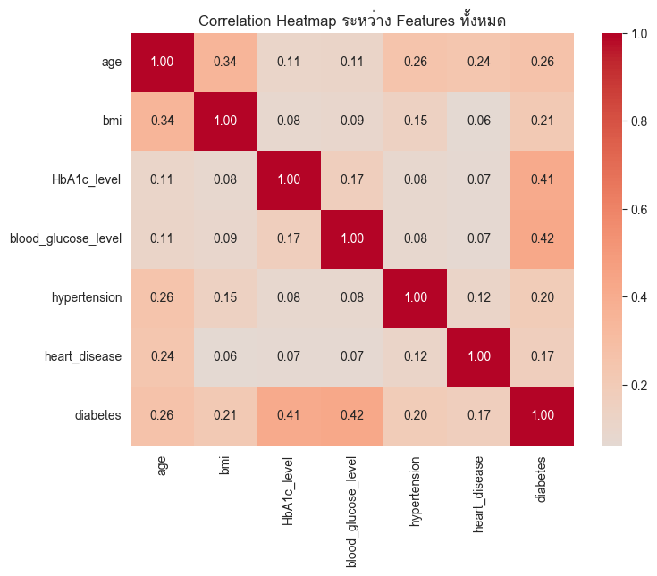

# HealthSense – Update Report: Phase 1

**รายวิชา:** CP462 Introduction to Data Science
**หัวข้อ:** HealthSense: Predicting Chronic Disease Risk from Daily Lifestyle
**สมาชิก:**
- นายวัชรพงศ์ มาลัง (67102010174)
- นาย นราธิป สุวณิชย์ (67102010517)

**สถานะ:** Phase 1 (Data Understanding, Cleansing, EDA) เสร็จสมบูรณ์ — Phase 2 (Pre-processing & Modeling) ยังไม่เริ่ม

---

## 1. ไฟล์ที่เกี่ยวข้อง

| ไฟล์ | รายละเอียด |
|------|-----------|
| `CP462_Project_HealthSense.ipynb` | Notebook หลัก (43 cells) รันบน Google Colab |
| `HealthSense_Pitching.pdf` | สไลด์นำเสนอ 8 หน้า + หน้า Thank you |

---

## 2. Problem Statement

- **ที่มา:** โรคเรื้อรัง (เบาหวาน, ความดันสูง, โรคหัวใจ) เป็นสาเหตุการตายอันดับต้น ๆ และป้องกันได้จากพฤติกรรมการใช้ชีวิต
- **คำถามหลัก:** จะทำนายความเสี่ยงโรคเรื้อรังจากข้อมูลพฤติกรรมประจำวันได้อย่างไร เพื่อให้คนรู้ตัวก่อนป่วยจริง
- **ผู้ได้ประโยชน์:** ประชาชนทั่วไป, หน่วยงานสาธารณสุข (คัดกรองกลุ่มเสี่ยง), บริษัทประกันสุขภาพ (ประเมินความเสี่ยง/ออกแบบโปรแกรมป้องกัน)
- **เป้าหมายที่วัดผลได้:** ใช้ผลจากโมเดลเป็นสัญญาณเตือนล่วงหน้า ลดสัดส่วนผู้ป่วยที่ตรวจพบช้า และเพิ่มอัตราการเข้ารับการคัดกรองก่อนมีอาการ

---

## 3. ชุดข้อมูล

- **ชื่อ:** Diabetes Prediction Dataset (Kaggle: `iammustafatz/diabetes-prediction-dataset`)
- **ขนาด:** 100,000 แถว × 9 คอลัมน์ (8 features + 1 target)
- **การโหลด:** ใช้ `kagglehub.dataset_download` (public dataset ไม่ต้อง login) แล้วอ่านด้วย pandas

| คอลัมน์ | ความหมาย | ชนิด |
|---------|----------|------|
| gender | เพศ (Male/Female/Other) | Categorical |
| age | อายุ (0–80 ปี) | Numeric |
| hypertension | ความดันโลหิตสูงหรือไม่ | Binary |
| heart_disease | โรคหัวใจหรือไม่ | Binary |
| smoking_history | ประวัติการสูบบุหรี่ | Categorical |
| bmi | ดัชนีมวลกาย | Numeric |
| HbA1c_level | น้ำตาลสะสม 2–3 เดือน | Numeric |
| blood_glucose_level | น้ำตาลในเลือดขณะตรวจ | Numeric |
| diabetes | **Target** (1 = เป็นเบาหวาน, 0 = ไม่เป็น) | Binary |

---

## 4. Data Cleansing

| # | ปัญหา | สิ่งที่พบ | วิธีจัดการ |
|---|-------|----------|-----------|
| 1 | Missing (NaN) | ไม่พบค่า NaN ในทุกคอลัมน์ | ไม่ต้องแก้ไข |
| 2 | Missing ที่ซ่อนอยู่ | `smoking_history` มีค่า "No Info" 35,816 แถว (35.82%) | แปลงเป็น category `unknown` แทนการลบ เพื่อไม่เสียข้อมูลแถวอื่น |
| 3 | แถวซ้ำ | พบ 3,854 แถวซ้ำ | `drop_duplicates()` → เหลือ **96,146 แถว** |
| 4 | Outlier ของ BMI | ตรวจด้วย boxplot ช่วงค่า 10.01–95.69 ไม่มีค่าผิดปกติสุดโต่ง | ไม่ตัดออก |
| 5 | dtype | `gender`, `smoking_history`, `hypertension`, `heart_disease`, `diabetes` เป็น object/int | แปลงเป็น `category` |

**ผลรวม:** 100,000 → 96,146 แถว (ลบเฉพาะแถวซ้ำ ไม่มีการลบเพราะ missing)

**BMI Boxplot (ตรวจ outlier)**

---

## 5. Exploratory Data Analysis (6 กราฟ)

| กราฟ | หัวข้อ | ข้อค้นพบ |
|------|--------|----------|
| 1 | สัดส่วนเป็น/ไม่เป็นเบาหวาน (bar) | ข้อมูล **imbalanced** ชัดเจน (ส่วนใหญ่ไม่เป็นเบาหวาน) ต้องจัดการตอนทำโมเดล เช่น oversampling, undersampling หรือ class weight |
| 2 | HbA1c และ blood glucose ตามสถานะเบาหวาน (boxplot) | กลุ่มเป็นเบาหวานสูงกว่าอย่างชัดเจนทั้ง median และ range สอดคล้องกับเกณฑ์วินิจฉัยทางการแพทย์ |
| 3 | BMI ตามสถานะเบาหวาน (boxplot) | กลุ่มเป็นเบาหวานมีแนวโน้ม BMI สูงกว่า |
| 4 | สัดส่วนเบาหวานตามประวัติสูบบุหรี่ (bar) | กลุ่ม former / ever / current สูงกว่ากลุ่ม never |
| 5 | สัดส่วนเบาหวานตามช่วงอายุ (line) | ความเสี่ยงเพิ่มขึ้นตามอายุอย่างชัดเจน |
| 6 | Correlation Heatmap | `blood_glucose_level` (0.42), `HbA1c_level` (0.41), `age` (0.26), `bmi` (0.21) สัมพันธ์กับ `diabetes` สูงสุด |

### กราฟ 1 · สัดส่วนเป็น/ไม่เป็นเบาหวาน

### กราฟ 2 · HbA1c_level และ blood_glucose_level ตามสถานะเบาหวาน

### กราฟ 3 · BMI ตามสถานะเบาหวาน

### กราฟ 4 · สัดส่วนเบาหวานตามประวัติสูบบุหรี่

### กราฟ 5 · สัดส่วนเบาหวานตามช่วงอายุ

### กราฟ 6 · Correlation Heatmap

**ข้อควรระวัง:** correlation เป็นความสัมพันธ์เชิงสถิติ ไม่ใช่ความสัมพันธ์เชิงเหตุและผล

---

## 6. สรุปผล Phase 1

- ความเสี่ยงเบาหวานเพิ่มขึ้นตามอายุอย่างสม่ำเสมอ (กราฟ 5) ส่วนตัวแปรที่สัมพันธ์กับ diabetes สูงสุดคือ `blood_glucose_level` (0.42) และ `HbA1c_level` (0.41) ตามด้วย age (0.26) และ BMI (0.21)
- พฤติกรรมการสูบบุหรี่ยังต้องวิเคราะห์เพิ่มเติม (โดยเฉพาะกลุ่ม `unknown` ที่มีสัดส่วนมาก)
- ปัญหาสำคัญที่ต้องจัดการต่อคือ **class imbalance**

---

## 7. งานที่ยังไม่ได้ทำ (Phase 2)

Notebook มีเพียงหัวข้อว่าง (cells 33–42) ยังไม่มีโค้ด:

- [ ] Data pre-processing (encode `gender` / `smoking_history`, scaling ถ้าจำเป็น, train/test split แบบ stratified)
- [ ] จัดการ class imbalance (class weight / SMOTE / undersampling)
- [ ] สร้างและเปรียบเทียบโมเดล (เช่น Logistic Regression, Random Forest, XGBoost)
- [ ] ประเมินผลด้วย metric ที่เหมาะกับข้อมูลไม่สมดุล: recall, F1, AUC (ไม่ใช้ accuracy อย่างเดียว)
- [ ] สรุปผลโมเดลและข้อเสนอแนะ

## 8. ข้อสังเกต / ประเด็นที่ต้องตัดสินใจ

1. **Target leakage เชิงแนวคิด:** `HbA1c_level` และ `blood_glucose_level` เป็นค่าที่ใช้วินิจฉัยเบาหวานโดยตรง หากใส่ในโมเดลจะได้ผลแม่นมาก แต่ขัดกับแนวคิด "ทำนายจากพฤติกรรมประจำวัน/ตรวจพบก่อนมีอาการ" ควรพิจารณาสร้างโมเดล 2 แบบเพื่อเปรียบเทียบ (มี/ไม่มีค่าตรวจทางคลินิก)
2. **Cell การติดตั้งฟอนต์ไทย** (cell 3) ใช้ `!apt-get` และ path ของ Linux จึงรันได้เฉพาะบน Google Colab
3. **Git:** ไฟล์ทั้งหมดยังเป็น untracked และยังไม่มี commit
 
 
 
 **Update 15/10/2026**